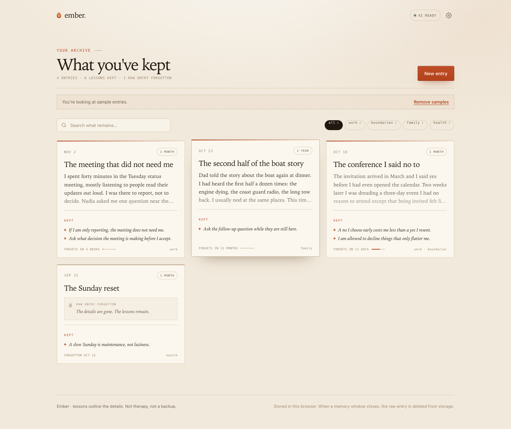

# Ember

**A journal with a shelf life. Keep the lesson, let the rest go.**

Write what happened. Ember distills the durable lesson with a local language model,
then lets the raw entry fade. When the memory window closes, the body is deleted
from `localStorage` for good. The lesson stays.

[Live demo](https://santiagorandolph.github.io/ember/) · try **Try a sample journal**;
no model needed.



## Why this exists

Journals usually fail in one of two directions. They become a museum of old
feelings, or they become a performance for a future self who never reads them.
Ember makes forgetting the point. You get the value of writing something down
without keeping a permanent record of a day that has already done its job.

The interaction is not a chatbot. It is a document that visibly decays, a button
that deletes the raw text, and a growing archive of things you actually learned.

## Run it

```sh
python3 -m http.server 8080
# open http://localhost:8080
```

Click **Try a sample journal** to explore the full archive, including a faded
entry and one whose details are already gone.

## Connect a local model

1. Install [Ollama](https://ollama.com) and pull a model:
   ```sh
   ollama pull llama3.1
   ```
2. Start Ollama with this page's origin allowed:
   ```sh
   OLLAMA_ORIGINS=* ollama serve
   ```
3. Open the gear icon, confirm `http://localhost:11434` and the model name, then
   **Test connection**.

`llama3.1` is the fast default. `llama3.3` tends to write sharper lessons if your
machine can run it. Any Ollama chat model that supports JSON output should work.

If the model is unavailable, nothing blocks you: write the lesson yourself. The
archive, decay, and deletion work entirely offline.

GitHub Pages serves this page over HTTPS, and Chrome blocks HTTPS pages from
calling `localhost`. The hosted demo therefore cannot reach Ollama. For the full
AI flow, run the app locally. The sample journal and manual lessons work
everywhere.

## How the forgetting works

Every entry gets a memory window:

| Window | Shelf life |
| --- | --- |
| One week | 7 days |
| One month | 30 days |
| Three months | 90 days |
| One year | 365 days |

While the window is open, the body fades visibly in the archive and detail view.
When it closes, the app sets `body` to `null`, records `forgottenAt`, and writes
the result back to storage. The raw text is not hidden with CSS; it is removed
from the saved entry. Search can no longer match it. Export cannot include it.

You can close a window early with **Forget the raw entry now**. That action takes
two clicks, because it cannot be undone.

Lessons are editable at any time. A forgotten entry can still gain a new lesson
from memory.

## What the model does

The model receives the entry and returns:

```json
{
  "title": "a short, evocative name",
  "lessons": [
    "the durable thing worth keeping",
    "another, if it is genuinely separate"
  ]
}
```

The prompt asks for first-person, concrete lessons under 150 characters. It
forbids summarizing events, generic advice, and therapy-speak. Ember then:

- strips duplicate and empty lessons
- caps the result at four lessons
- keeps your title if you already wrote one
- leaves the entry fully editable

Distillation is a suggestion, not an authority. Rewrite anything that sounds
like a fortune cookie.

## Privacy

- Entries live in this browser's `localStorage`.
- With the default `localhost` endpoint, the text is sent only to your machine.
- There are no analytics, cookies, accounts, or third-party assets.
- Forgotten bodies are deleted from storage, not just visually hidden.
- Export is a local JSON download of whatever remains.

This is not a backup. Clearing site data deletes the archive.

## Limits

- A local model can invent depth or flatten a complicated day. You are the editor.
- Fading is a design cue, not encryption. While the window is open, the body is
  readable in storage. Anyone with access to the browser profile can read it.
- `localStorage` is per-browser and per-origin. It does not sync across devices.
- The app only supports Ollama's native `/api/chat` format. No cloud API keys.
- Export before clearing site data if you want a copy of what remains.

## Files

```
index.html    structure and copy
styles.css    paper styling, serif type, decay treatment
engine.js     decay math, purge, lessons, search, export (pure)
ai.js         Ollama client and distillation prompt
example.js    curated sample journal with fresh, fading, forgotten states
app.js        rendering, composer, detail, purge loop
test.js       Node tests for the engine
favicon.svg   ember mark
```

## Tests

```sh
node test.js
```

14 tests cover span math, decay progress, non-mutating purge, humanized
time, entry sanitization, lesson/tag caps, search excluding forgotten bodies,
tag counts, export, sample states, and JSON extraction.

The browser flows were also checked with Playwright: sample archive, lesson
editing, two-click forget, sealing an entry, live distillation through
`llama3.1`, search and tag filters, automatic purge on load, settings/export,
and mobile layouts with no horizontal overflow.

## A note on the name

It was briefly called Half-Life. **Ember** is better: the fire is out, but
something warm and useful is still in your hand.
