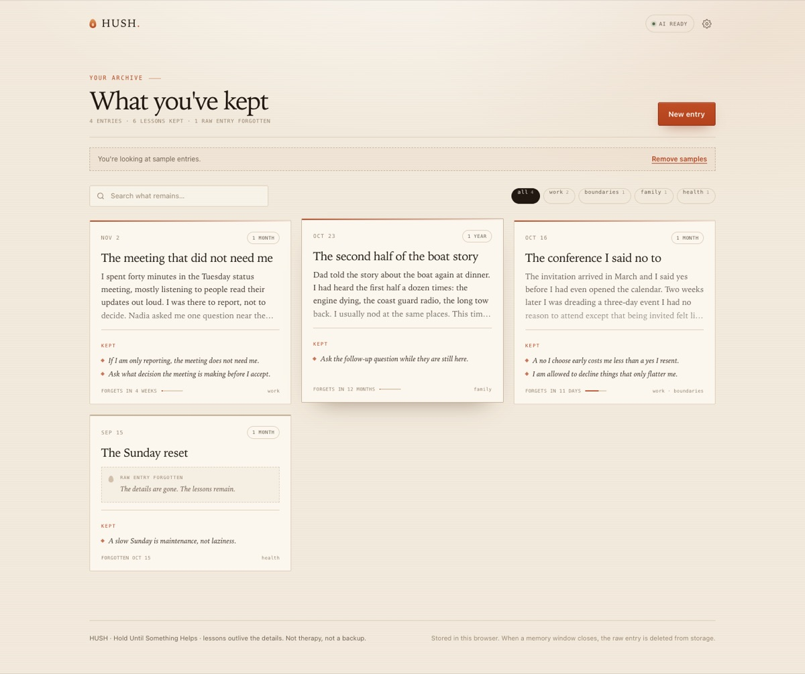
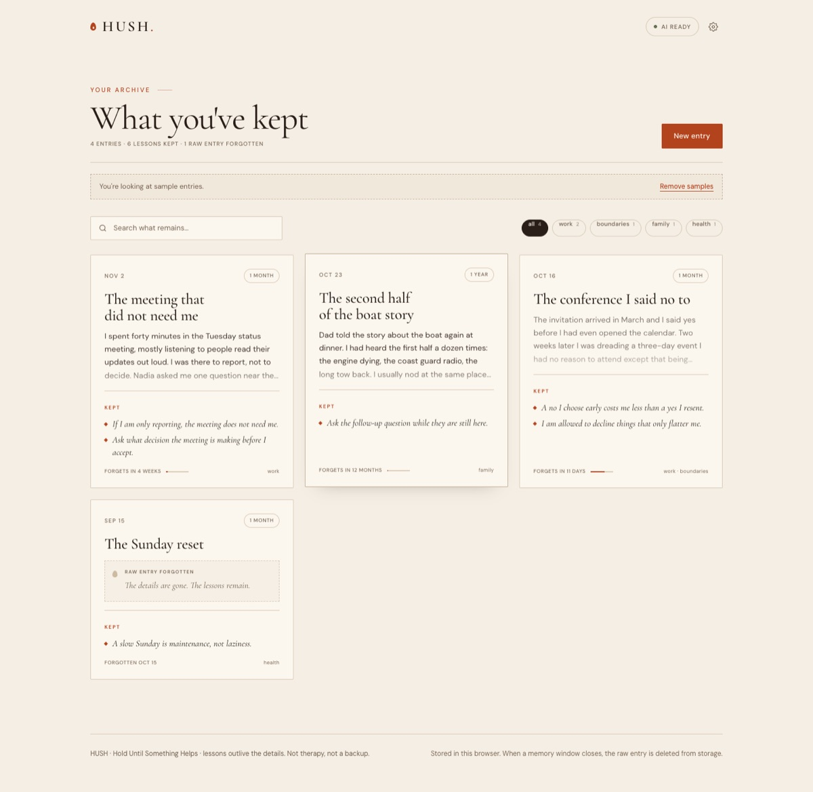
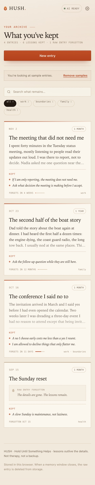
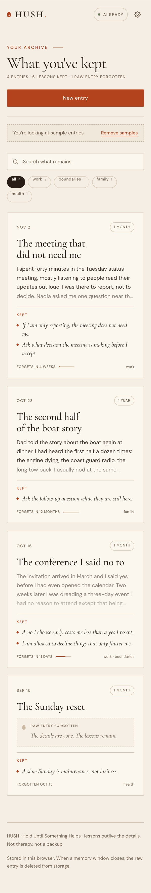
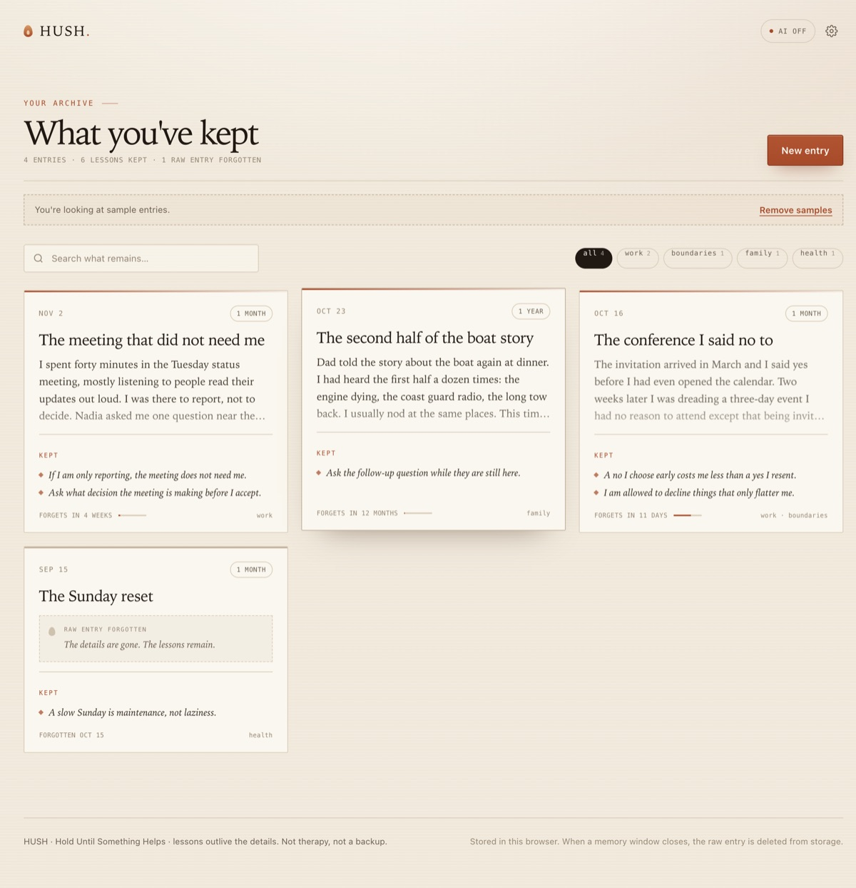
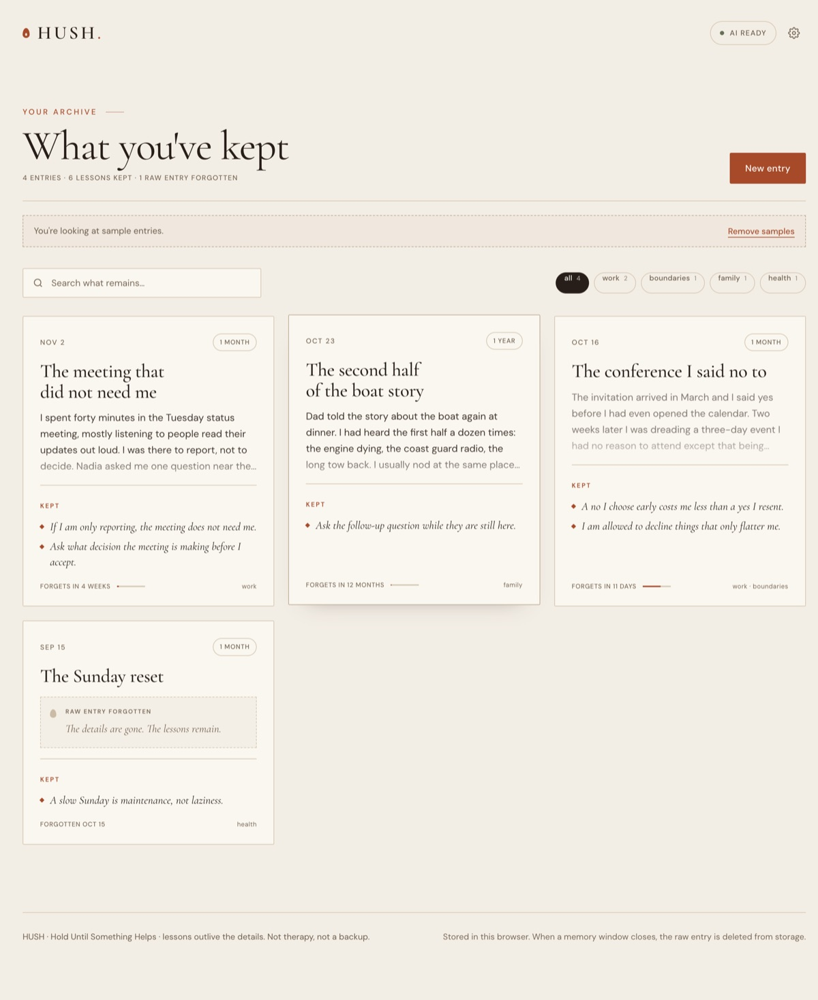
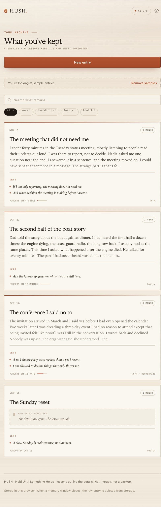
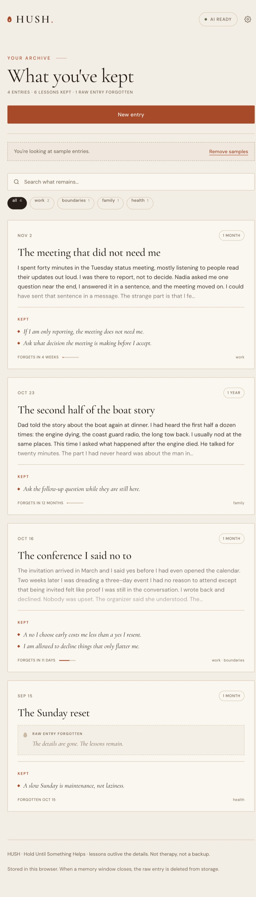

# Editorial redesign — visual comparison

Captured from the local website and the packaged macOS app before and after the
typography and palette update. The website views are 1440px and 390px wide; the
app views are 1180px and a 640px narrow window.

## Website

| Before | After |
| --- | --- |
|  |  |
|  |  |

## macOS app

| Before | After |
| --- | --- |
|  |  |
|  |  |

The screenshots use the built-in sample journal so the fresh, fading, and
forgotten states appear together. No personal entries are shown.
